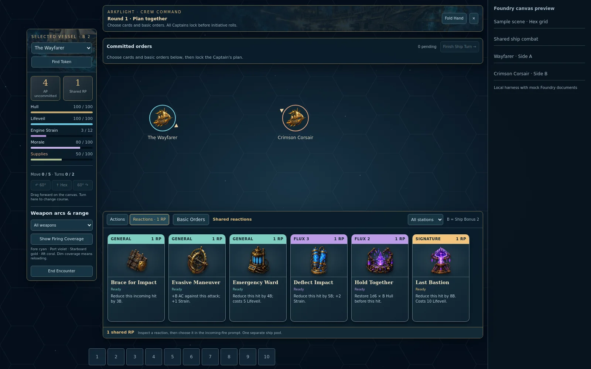
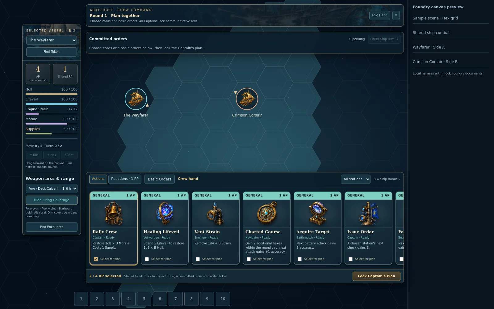

# Connected Card Combat playtest

18 October 2026. This is the first playable slice of the proposed 1.1.0 system, not the full release. It includes **16 AP cards and 6 RP cards** from the planned 105-card collection.

## Get the build and open it

In the existing **arkflight-game** module repository (not the separate arcflight repository), fetch the feature branch:

```bash
git fetch origin
git switch feat/station-ability-loadouts
git pull --ff-only origin feat/station-ability-loadouts
npm test
```

Reload Foundry clients after updating. Open **Game Settings → Configure Settings → Arkflight Game → Open Card Combat**. The module setting menu is available to players as well as the GM. Alternatively, run this script macro:

```js
await game.arkflight.cardCombat.open();
```

Open a **hex-grid scene** before launching. The primary active GM must view the bound scene while processing commands. Both pointy-top and flat-top hex layouts are supported; square/gridless scenes are rejected explicitly.

The GM selects two to eight existing armed Arkflight ship Actors and at least two sides. Click **Place Selected Ships on Scene** to create only missing linked tokens, or drag the Actors onto the scene yourself. Existing positions are preserved during placement. If an Actor has several linked tokens, select the intended one in its token dropdown. Click **Launch Canvas Encounter**. Starting facings snap to the scene's six legal headings and token centers align to hex centers.

The setup window changes into a canvas HUD. Assigned crew clients receive it automatically on a new encounter; closing the HUD hides it without ending combat. Reopen it through the same macro or the card button on a participating token's normal HUD. An earlier standalone chart encounter must be ended before starting a canvas encounter; its imaginary positions are not imposed on your scene.

## Import the four packaged test ships

On the launch screen, the GM clicks **Import 4 Test Ships**. If an encounter is already running, end it to return to the setup screen. The ships appear in the Actor folder **Arkflight — Combat Test Fleet** and in the vessel picker. Nothing is imported automatically into campaign worlds.

| Vessel | Profile | Suggested side |
| --- | --- | --- |
| [Test] Wayfarer | Standard brigantine / Tidewake engine | A |
| [Test] Swiftwake | Racing brigantine / Tidewake engine | A |
| [Test] IronSpear | Standard frigate / Iron Choir engine | B |
| [Test] Resolute | Battle frigate / military Iron Choir engine | B |

All four are level 5 with six legally mounted weapons (fore, aft and two per broadside), full Hull, Lifeveil, drive, Arkengine integrity, Morale and Supplies, zero Strain, and independent random 12-card AP / 6-card RP hands. They use the real catalog profiles rather than overriding balance values. The GM can operate all stations using the existing Trained NPC fallback; assign real player crew before starting to test player permissions and skill ranks.

Importing again reuses the test Actors by a stable flag, even after renaming them. It preserves edits, resources and existing card libraries, and recreates only missing vessels. Same-name campaign Actors are not treated as test ships. Commands run through the primary GM's serial queue, and import never replaces the active encounter. You still choose which vessels to include and can edit their suggested side labels; use two for a duel or all four for a two-versus-two test.

Test ships keep the original gold vessel illustration as their Actor portrait and use a transparent overhead token on the canvas: `modules/arkflight-game/assets/ui/stations/voyage_vessel_token_topdown.webp`. The art points bow-up at rotation 0°, with port on the left and starboard on the right when viewed in that orientation. It rotates with the token. **Import 4 Test Ships** also upgrades existing marked test Actors and their linked scene tokens if they still use the original portrait illustration as token art. Custom artwork, positions, current headings, scale, resources and hands are preserved; campaign ships are excluded. To use it for another ship, choose this file as its Prototype Token texture and update any already placed tokens separately.

The same opt-in action is available to a GM macro:

```js
await game.arkflight.cardCombat.importTestShips();
await game.arkflight.cardCombat.open();
```

## Canvas HUD and card hand

### Guided three-round test — you click every step

As GM, open **Configure Settings → Arkflight Game → Open 3-Round Test**, or choose **Guided 3-Round Test · Next Step** in the card HUD's Options. The encounter setup window also has a **Guided 3-Round Combat Test** button. Opening the guide only displays it; it does not start or advance combat.

1. End any running card/native Foundry encounter and unpause Foundry. The test refuses to take over an active encounter.
2. Click **Next Step** to prepare a separate **[Test] Arkflight — Guided Combat** hex scene with four dedicated **[Demo]** ship Actors/tokens. It views that scene for the executing GM, without activating it for all players. These fixtures are distinct from both campaign vessels and the editable four-ship test fleet.
3. Read **Next** and click **Next Step** once per action. One click locks one Captain's plan, moves/turns a ship, executes a card, inspects coverage, fires a battery, answers one defender, or finishes a ship turn. The final Captain's lock automatically rolls initiative through the ordinary rules. Coverage inspection and firing are separate steps; split-volley defenders resolve separately. There is no autoplay or timer advancing the sequence.
4. Inspect the persistent **Last result**, fixed dice and step history. Results include authored card outcomes, actual resource changes, attack-vs-AC, combined defense reduction and final Hull damage. Movement reports hexes, facing and remaining free allowance. **Ship resources, weapons & cards** shows each weapon's range/ready round and a **Ready cards only** filter; **Show firing coverage** allows an additional local inspection.
5. Continue through all three rounds. Round 1 includes support, a split broadside, reactions and Work the Guns; round 2 includes Drive the Crew and a separate plan for its earned AP; round 3 reuses the Flux 2 Breakaway Vector. Initial/final movement, turning, round reload readiness, fresh initiative and resource/AP/RP changes use the actual combat dispatcher and native token adapter.
6. Review the final checklist. The engine reaches round 4 planning only to establish that round 3 finished, then the next click ends the demonstration before any round 4 actions or initiative. The scripted sequence currently takes about 108 combat/inspection clicks after setup; labels explain each one.

**Stop Test** ends only the demonstration and leaves its ships/scene for inspection. **Reset** stops a running demonstration and returns the guide to its setup prompt; the next click reuses and resets only the marked demo tokens and fresh encounter copies. It does not delete documents or alter campaign ships. A demo scene with added walls or non-demo tokens refuses reset so that added content is not disturbed. Closing/minimizing the guide does not advance anything; reopen it from settings or Combat Options. The active primary GM must view the bound demo scene to advance. Stop remains available while Foundry is paused.

The test deliberately uses **fixed, labeled demonstration dice** rather than live random rolls, with normal card/attack/defense/cost rules and NPC Trained skill ranks. It is a repeatable teaching/flow test, not an AI opponent or a balance simulation. Native tracker changes, token moves, cards, animations and sound use the existing integration; enable sound in Combat Options as usual. Manual order buttons are disabled during the guide, and the authority rejects manual commands that would desynchronize the script. Stale/double clicks and storage failures leave the pending step recoverable.

Current validation: **788 Node tests pass**. Eight new tests run the full three-round script, check read-only next-step queries/replay, authorization, pause/takeover guards, real adapter sequencing over mocked documents, fixture reuse, duplicate requests, Actor data preservation and movement rollback after a rejected save. Chromium clicks the actual guide through 108 steps with 12 coverage previews and 13 defender responses, then exercises Reset/Stop, pause, filtering and a smaller viewport without JavaScript errors. The Foundry documents/frame are mocked in these checks; live v14/PF2e scene construction, native rendering, speakers and multiplayer remain acceptance work.



This earlier preview renders the actual HUD over a mock canvas, not a running Foundry world. The current compact controls are described below.

- The movable hand shows about five readable portrait cards at its default size, with horizontal scrolling for the rest. Full-width **General teal, Flux violet and Signature gold** bands identify each type. Click a card to expand its artwork and all four outcomes.
- Everyone can inspect the shared hand. **All stations / My stations / a named station** filters preserve the selected AP plan. **Actions / Reactions** use separate tabs and pool readouts. **Basic Orders** jumps to the repeatable basic-order counts; these do not occupy card slots.
- A solid, readable command strip is attached immediately above the card hand: selected vessel, phase, AP/RP and **Ship / Orders / Cards / Options**. **Move** moves the strip and cards together. **Ship** opens its resource/helm dashboard. Selecting an encounter token follows that vessel in the HUD.
- **Orders** opens the committed queue. Click an order or drag it onto a participating canvas token to open the same execution preview. For Fire Battery, dropping selects an enemy, or use normal Foundry targeting and **Use Foundry Target**. Choose a skill and battery, then click **Roll / Execute**. Dropping alone never spends or rolls the order.
- A pending attack opens the defending crew's Reactions tab. Inspect a reaction and choose it, or drag it onto the defending token. Then **Resolve Response**, or pass. The engine continues automatically after a legal response; the GM does not approve player commands.
- **Minimize** hides the cards and leaves just the command strip, including **Cards** to restore them. A successful **Lock Plan** does this automatically by default. An eligible pending reaction temporarily reopens the hand, then restores your minimized preference. Local selections, execution fields, reaction choices and scroll survive shared-state refreshes.

## Weapon arcs and firing range



Open **Ship → Weapon arcs & ship controls**, select **All weapons** or an individual installed weapon, then **Show Firing Coverage**. Exact hex polygons use the same range and arc predicate as battery firing, including temporary widened-arc effects. Minimum-range dead zones are excluded. Fore is cyan, port violet, starboard gold, aft coral and deck green. Reloading-only coverage is dimmed; the dropdown gives ready rounds and min–max range. With overlapping weapons on one mount, coverage is bright if any covering weapon is ready.

Coverage follows the session's native grid geometry, position and facing. It is a local visual aid and does not roll attacks, spend AP or add persistent scene drawings/templates. Hide it with the same button; closing the HUD, ending combat, changing selected vessels or tearing down the canvas clears it. Return to the bound scene to view coverage after switching scenes.

### Weapon patterns and controlled broadsides

End an older playtest encounter and launch a fresh one after updating: new encounter snapshots now retain each installed weapon's catalog arc. Existing saved encounters do not acquire missing weapon metadata automatically.

| Aiming pattern | Full width | Attack behavior |
| --- | --- | --- |
| Precision / line | 60° | One chosen ship; the name describes aiming tolerance, not a piercing area attack. |
| Broadside | 90° | A port or starboard cone; concentrate on one ship or assign different installed weapons to different ships inside it. |
| Wide | 180° | One chosen ship. Swivel cannons retain flexible aiming without becoming area attacks. |
| Turret | 360° | One chosen ship; only weapons explicitly carrying the turret pattern receive all-around coverage. |

The mount supplies direction and the weapon supplies width. A deck mount by itself does not grant turret coverage. **Set Attack Vector** still widens eligible aiming arcs. Displayed hex coverage and shot legality share the same weapon-specific predicate. The shared targeting helper also narrows legacy broadside arcs from 120° to 90°; split-fire controls are exclusive to card combat.

**Concentrate fire** remains the default. Choose an enemy and mounting side in a committed **Fire Battery** order, then leave the eligible weapons checked or uncheck weapons to hold them ready. Guns outside that target's range or arc cannot participate.

For **Split broadside**, choose Port or Starboard, then select that mode. Assign each broadside installation to an enemy in its own legal range and arc, or leave it on **Hold fire**. Swivels and other non-broadside weapons cannot be included in split fire. Each installed weapon is indivisible; an item named “Broadside Cannon Battery” still counts as one installed weapon for assignment. Two distinct targets therefore require at least two participating installations.

**Preview selected fire** shows coverage for the chosen weapons and outlines the selected target hexes. It spends nothing. Change the choices to clear that preview, or hide firing coverage. A shared encounter revision also clears the preview so it cannot silently represent an old assignment. Click **Roll / Execute** to fire.

One committed Fire Battery order costs its existing **1 AP**, regardless of target count, and uses **one shared attack roll**. Roll each participating weapon's damage once: the highest roll contributes fully and each other roll contributes half, rounded down. Each contribution goes only to that weapon's assigned target. A volley damage bonus is added once to the highest-roll contribution; ties use the first selected weapon. A negative damage modifier reduces that contribution first, then the remaining contributions, never below zero. Splitting therefore redistributes the concentrated damage pool instead of creating another full-damage pool per target.

Each target compares the shared attack total against its own AC, receives its own reaction/pass window, and applies its own critical result, Hardness and defenses. Prompts advance automatically through the selected targets. Accuracy/damage/penetration buff uses are consumed once per volley; each target receives the same applicable penetration. All other actions and movement stay paused until every response finishes. Only fired weapons start their printed reload timers; held weapons remain ready. Ships merely standing elsewhere in the cone are not automatically attacked.

## What the playtest saves

- The first enrollment of a ship with no new card library permanently deals 8 General / 3 Flux / 1 Signature AP cards and 3/2/1 RP cards onto that Actor. Each station receives a usable General card. These are chosen randomly from this small batch.
- An existing new-style library and hand are reused. A new encounter never rerolls them. A hand containing cards outside the playtest catalog produces an explicit error rather than deleting those cards.
- The shared encounter, plans, positions, resources, reload ready rounds, reactions and log are stored in a world setting, so all clients see the same state and a reload can resume it.
- Encounter Hull, Strain, Morale, Supplies and Lifeveil remain **copies** for safe testing. Combat effects do not write those resources to live ship Actors. The permanent first card library remains an intentional Actor write.
- **Scene token positions and facings are real.** Ending a playtest leaves tokens where they moved. The placement helper creates linked one-hex test tokens only when missing; it never silently chooses among multiple tokens for an Actor.
- Launch creates a marked native Foundry Combat containing the chosen scene tokens. Its tracker mirrors rolled initiative, round, defeated markers and the active ship. **Lock Plan / Finish Ship Turn in the card HUD own advancement**; native tracker round/turn controls cannot bypass planning or reaction windows. Legacy hull AP, reload, facing and loadout initialization are not attached to this marked encounter. Existing combat remains available separately.
- Equal initiative scores retain the card engine's Actor-ID tie order; the native tracker selects the correct active row even if its own tied-row sort differs. The HUD/engine controls advancement.

## Run one round

1. Select a ship in the window. The Captain checks cards and chooses counts for basic orders. Each selected operation costs 1 AP; the starting pool is 4 in this slice.
2. Click **Lock Captain's Plan**. AP is committed and normal card costs are reserved. Targets and batteries are still undecided.
3. Repeat for every ship; the GM operates enemy Captains. The last submitted initial plan automatically rolls initiative for all operational ships.
4. The active ship's Navigator can drag its actual token straight forward, or use **↑ Hex** and the **60°** turn buttons. Wheel rotation becomes one legal facing step. A new course requires a turn first. Movement is free within the allowance and can stop to fire before continuing. Turning twice in the same hex is blocked. Occupied hexes, walls, exhausted movement and non-Navigator commands are rejected without spending budgets. Native token drag requires normal owner permission on the ship token; assigned Navigators can always use the authorized HUD controls.
5. Assigned players click a committed card/order to open its preview, choose a permitted skill and any required choice, then **Roll / Execute**. Execute orders in any sequence. The Captain can request a player's execution or reassign an unresolved order to another crew member. A GM can resolve any assigned order.
6. For **Fire Battery**, click the order and use a normal Foundry target, choose an enemy in the preview, or drag the committed order onto an enemy token. Choose the battery during execution. A legal ready battery rolls once to hit; damage dice are separate. Other orders and movement pause at the defending crew's reaction prompt.
7. Defenders choose a reaction or **Pass**. Their shared RP starts at 1. The attack then resolves against AC, applies its critical degree, Hardness, wards and any reaction, and updates the copied Hull once.
8. **Finish Ship Turn** skips remaining orders without refunding committed AP or consuming skipped cards. After every operational ship acts, a new planning round starts. It restores AP/RP and movement budgets once; cooldowns use absolute ready rounds. After all new plans lock, initiative rerolls.

The Captain may submit additional locked orders funded only by AP explicitly earned during that turn (for example, Drive the Crew). Original unallocated AP does not reopen the old plan.

## Initial executable cards

| Station | General | Flux |
| --- | --- | --- |
| Captain | Rally Crew; Issue Order | Coordinate Assault |
| Engineer | Vent Strain; Feed the Guns | Redistribute Power |
| Navigator | Charted Course; Set Attack Vector | Breakaway Vector |
| Battlewatch | Acquire Target; Ready Broadside | Work the Guns |
| Veilwarden | Mend Lifeveil; Healing Lifeveil | Reinforce Lifeveil |

The first AP Signature is **Drive the Crew**. The RP batch contains General **Brace for Impact, Evasive Maneuver, Emergency Ward**; Flux **Deflect Impact, Hold Together**; and Signature **Last Bastion**. Each card displays four individually written outcomes. The rest of the planned collection is not present yet.

## Explicit playtest defaults

These numerical defaults remain provisional while the connected card flow is playtested:

- Ordinary checks retain the existing ability DC helper: `9 + Ship Bonus`. Roll `d20 + Ship Bonus + skill rank contribution + applicable ship/station modifiers`. Rank contributes 0–4, not the full PF2e skill modifier.
- Use standard four degree calculation from the existing rules helper, including natural 1/20 shifts. Non-attack operations deliver their base effect with their written rider. Damage/recovery dice determine strength separately.
- The first batch, Flux durations, numerical kickers, new General Feed the Guns and Flux Breakaway Vector are provisional card designs. Most recovery quantities reuse prior abilities. Detailed text is in `src/content/combat-cards-playtest.js`.
- Matching temporary bonuses use the strongest positive plus the strongest negative of a category. Accuracy and damage are separate. One-use buffs are consumed by the qualifying operation; temporary effects expire at the start of that ship's next turn.
- A battery attack uses selected ready weapons on one mounting side. Its damage is the highest rolled weapon damage plus half (rounded down) of each other participating weapon's rolled damage. Weapon Impact/Potency are read from installations. A controlled split broadside divides those contributions among selected targets. Hardness is applied once per defending ship after its critical result. This formula needs playtest balancing.
- Ship attack base is `level + 4 + B + selected skill rank + ship weapon accuracy + minimum participating Potency`, plus temporary bonuses. Initiative uses `d20 + level + B + Navigator Survival rank`. Both are provisional, ship-owned numerical bases.
- Printed weapon reload N sets readiness to current round + N. A zero-reload weapon can fire again for another committed basic order. Work the Guns can bring a future ready round down to the current round.
- Use derived ship speed capped at 6; giant profiles cap at 3 and have one normal turn, other ships have two. Purchases can add at most one more full movement allowance and one more turn. The playtest uses one hex per ship. Native wall checks constrain movement; wind, terrain movement costs, ramming, grapples and boarding remain pending.
- Basic Damage Control restores `1d4 × B` copied Hull for 1 AP. Its final named-fault suppression/repair behavior remains a separate design step.
- Missing station assignments use explicit NPC crew at Trained (+1) for this playtest. Assigned PF2e actors contribute their selected skill rank; the UI always provides the three station skill choices. Takeovers use the replacement actor's rank.

## HUD placement and dashboard controls

The command strip lives on the hand rather than at the top of Foundry's canvas, avoiding the reported scene-menu collision. Both move together and fit between visible left controls and the sidebar/chat area, including a floating chat input. Expanded navigation and the hotbar reserve space. Resizing or toggling Foundry panels recalculates placement without rebuilding the hand or changing selections. **Lock Plan** remains beside the AP counter in the hand footer.

The hand defaults to 900 × 330 pixels with about five cards visible. **Ship** opens a separate dashboard for resources, helm and weapon coverage; **Orders** opens the queue. Both start hidden. These are client presentation controls and do not spend AP/RP or alter ship data.

- Use either panel's **Move** handle, right/bottom edges or corner resize grip. **Pin** prevents accidental moving/resizing; **Unpin** restores it.
- **Minimize** leaves the attached command strip, with Ship, Orders, AP/RP, Options and the **Cards** restore button. It keeps its bottom edge and can still move or pin. The Ship panel has its own Minimize control.
- Sizes, positions, pins, minimized state and Ship visibility are saved per client. Viewport changes clamp panels into available space.
- **Options → UI scale** changes card/control size independently of browser zoom (85–140%). **Auto-minimize after lock** can be disabled there.
- **Reset panels** restores compact defaults. Focused move/resize handles support arrow keys (10 pixels), Shift+arrow (40), and Home to reset position.
- Closing/reopening preserves the saved layout and releases observers and pointer listeners.

Automated layout/workspace tests cover safe bounds, compact defaults, scaled placement, saved anchors, dragging/resizing/pinning/reset, automatic/manual minimization and temporary reaction reopening. Live Foundry acceptance with floating chat and expanded tools remains pending.

## Motion and sound

Open **Options** on the attached strip for **Motion: Full / Subtle / Off**, independent **Sound on/off** and volume percentage. The menu opens into available space without covering its toggle. Motion/sound controls also appear in Configure Settings → Arkflight Game. Preferences belong to each client. Sound starts off and unlocks after a browser interaction. Card selection, inspection, closing, pinning, locking and recovery now use eight bundled **physical card slides, tabletop taps and fanning samples**, with slight variations. Hovering, scrolling and dragging stay silent; rapid bursts drop instead of queuing. Combat retains synthesized cannon blasts, impacts, engines, wards, Signatures, reactions and roll outcomes. No extra module or external audio download is needed during play. OS reduced motion disables visual movement; sound remains separately controlled.

The physical samples are Kenney's Casino Audio 1.1 (CC0). Source, original license and cue mapping are included in [the audio credits](../assets/audio/card-combat/README.md). Missing or unsupported samples stay silent without blocking commands.

Full motion adds card lift and band glints, a card-to-order transition, separate AP/RP crystal feedback, the brass plan latch, panel opening/minimizing feedback, a brief active-vessel accent, roll/outcome highlights, reaction-hand entrance, round-based Flux recovery and spent Signature styling. Confirmed cannon fire draws flashes/trails to assigned tokens; translated ships get a short stern flare. Ward reactions get green/gold Lifeveil accents. Signature effects distinguish the Captain's compass burst from Last Bastion's veil ring. Resource deltas float over tokens and bars ease to new values. A brief result message includes the unique authored outcome; the last result remains in Orders after the message disappears, including with motion off.

Subtle retains short HUD feedback, one restrained trail per target and resource/turn indicators while omitting muzzle flashes, engine plumes and large Signature art. Off keeps the static art, status text, resource values and outcome highlight. No cosmetic effect waits before an order can execute or before the next command. The overlays ignore pointer input, follow the native canvas transform and clean up on scene teardown. No additional effects module is required.

Playback follows confirmed shared encounter revisions on each client. Duplicate hooks cannot replay a volley; first snapshots, reconnects and missed revision gaps establish a baseline without replaying old effects. This is best-effort local presentation of synchronized state, rather than frame-locked video playback. Closing the HUD does not hide shots on the scene; ending the encounter or leaving its scene clears transient effects.

## Acceptance checks

- Expand Foundry's scene menu. Move the hand and confirm the attached strip follows, then minimize and move the remaining bar; Cards must restore at the new anchor. Resize, pin and reopen both panels. Check floating chat clearance, readable Lock Plan and UI scaling. Confirm a rejected lock keeps the hand open, a successful lock folds it, and a pending reaction temporarily reopens it. Disable automatic minimizing and repeat.
- Before the first roll, enable sound in Options, adjust volume, select a card, lock a plan and fire. Confirm distinct sounds, silence at zero/mute, and independent motion settings. Check actual speaker output on both clients.
- Compare Full/Subtle/Off and sound on each client. Enable OS reduced motion; confirm card lift, smooth HUD scrolling/panning and canvas effects stop while controls and static outcomes remain usable. Toggle Off during a volley, then change scenes; effects must disappear without changing combat state.
- On both clients, lock a plan, resolve a card and its unique outcome, fire a split volley, react, and watch a Flux return at its printed round. Confirm one volley per command despite duplicate notifications, readable resource deltas, no blocked controls and no old effects after a reload.
- Use one GM and at least one actual player client. Verify only the Captain can lock, an assigned player can execute their order, another player cannot, and GM fallback works.
- Watch both windows update after plan submission, initiative, movement, a card, an earned-AP additional plan and a reaction. A player's local checkbox draft should survive another client's updates.
- Repeat-click an execution button: it must not charge twice or grant AP twice. Invalid targets leave an order pending; a truly impossible order or missing reserved resources skip cleanly.
- Use a Flux 2 card in round 1. It must be available at the start of round 3. A Signature remains spent through subsequent rounds.
- Fire two batteries with movement between them. Check six headings, range/arcs, one attack roll per battery, reload readiness and the reaction prompt. A team with two surviving friendly ships must not prevent victory when the opposing side has no operational ships.
- Compare a precision weapon, swivel and broadside on the canvas: 60° / 180° / 90° before temporary widening. Put two enemies inside a side cone, split two broadside installations between them, preview, fire, and resolve both reaction prompts. A third ship elsewhere in that cone must remain untouched. Held swivels must remain ready. Try a friendly, reloading or out-of-arc assignment: the authority must reject it without resolving the order.
- End and start a second encounter. The Actor's card library and equipped hand must be identical; only encounter recovery resets.
- Check that tokens really move/rotate on both clients and the native tracker selects the active ship. Live Actor resources must remain unchanged by playtest effects. First libraries intentionally save to Actors.
- Try both card clicks and drag-to-token targeting. A drop should open the preview without consuming the order. Repeated execution clicks must not roll or charge twice.
- Show one weapon's coverage, rotate/move, and verify edge hexes/minimum range against actual targeting. Test Set Attack Vector and reloading weapons. Close the HUD or change scenes and confirm coverage cleanup.
- Place the same selected ships twice: token count and existing positions must remain unchanged. Verify multiple tokens for one Actor require an explicit choice. End an encounter, reopen setup and start from the ships' current real positions.

Remaining work includes all 83 other card designs, outside-combat library/award/equip UI, complete equipment/talent properties and resistances, the reduced damage/save architecture, engineering overload/faults, deeper native integration (including tracker controls) and production UI assessment. Strain is currently bounded to its copied capacity, without a new Engineering save or overload consequence. These omissions make this a card-flow playtest rather than a complete combat replacement.

The player request adapter uses Foundry's server-provided creation user ID and message author rather than trusting a claimed requester in a socket payload. See the [Foundry v14 ChatMessage lifecycle](https://foundryvtt.com/api/v14/classes/foundry.documents.ChatMessage.html) and [generic document hooks](https://foundryvtt.com/api/v14/modules/hookEvents.html). An active GM processes and persists shared commands automatically; no GM approval click is required for a legal player order.

## Validation recorded

The attached workspace/audio build passes **780 Node tests**, including geometry checks for the attached/minimized strip, sample-only paper playback/variation and unavailable or still-loading files. Existing layout, presentation, rules, authority, movement, rollback, targeting, coverage and deployment tests remain passing. Audio checks cover user-gesture gating, zero volume, bounded voices and cleanup; they do not establish speaker quality.

The real templates/styles and pure combat dispatcher were exercised in Chromium with mocked Foundry applications/documents and a simulated scene. Checks cover attached placement below an expanded scene list, a solid background, movement in expanded/folded states, menu clearance, five-card visibility, resizing/pinning, saved state, scaling, draft preservation, lock folding, reaction reopening and split targeting. Screenshots were inspected at 1600×1000 and 1366×768 with expanded tools/floating chat, no page overflow and no JavaScript errors.

Presentation checks cover confirmed effects, duplicate suppression, Full/Subtle/Off, OS reduced motion and teardown. Chromium decodes all eight bundled Ogg files and schedules sample playback without oscillators for card interactions. Combat sources still schedule separately. These checks verify decoding/playback scheduling, not audible output or sound quality.

Actual Foundry v14/PF2e token movement, token HUD chrome, native canvas placement, audio output, ownership and multiplayer acceptance remain pending. The mock/browser checks do not establish those live-world results. Use one GM and one player client for acceptance before campaign play.

The adapter follows the documented [v14 token movement API](https://foundryvtt.com/api/v14/classes/foundry.documents.TokenDocument.html#move), [preMoveToken hook](https://foundryvtt.com/api/v14/functions/hookEvents.preMoveToken.html), [hex grid coordinate API](https://foundryvtt.com/api/v14/classes/foundry.grid.HexagonalGrid.html) and [ApplicationV2 frame configuration](https://foundryvtt.com/api/v14/interfaces/foundry.applications.types.ApplicationWindowConfiguration.html). It does not manufacture or override Foundry movement IDs.
