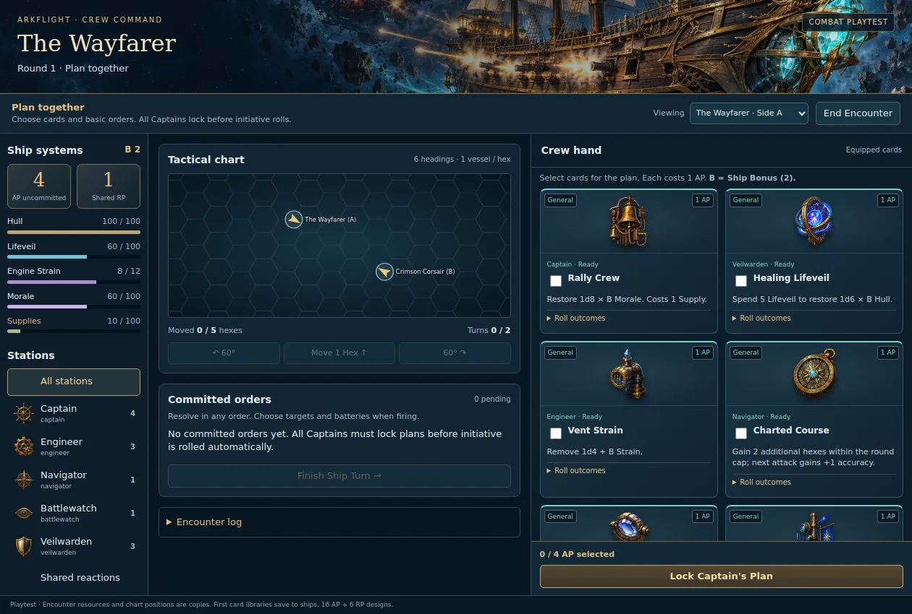

# Connected Card Combat playtest

17 October 2026. This is the first playable slice of the proposed 1.1.0 system, not the full release. It includes **16 AP cards and 6 RP cards** from the planned 105-card collection.

## Get the build and open it

In the laptop's existing module repository, fetch the feature branch without applying a patch:

```bash
git fetch origin
git switch feat/station-ability-loadouts
git pull --ff-only origin feat/station-ability-loadouts
npm test
```

Reload Foundry clients after updating. Open **Game Settings → Configure Settings → Arkflight Game → Open Card Combat**. The module setting menu is available to players as well as the GM. Alternatively, run this script macro:

```js
await game.arkflight.cardCombat.open();
```

The GM chooses two to eight existing Arkflight ship Actors and assigns at least two opposing side labels. No specific ship name is assumed. Ships must have an installed weapon for this first combat batch. Using multiple clients is supported by the request adapter, but still needs acceptance in a real Foundry/PF2e world.

## Temporary Crew Command board



The sample above is a local browser render with mock Foundry documents, not a live world screenshot. The temporary UI now provides:

- A space-sailing combat banner, station portraits, and distinct equipment art for all 22 cards. General, Flux and Signature cards use different accent colors; each retains its written four outcomes.
- A fleet/crew rail with copied resource bars, shared AP/RP and Ship Bonus. Select a vessel in the fleet or the viewing dropdown, then filter the hand by station or open the separate shared reaction hand.
- A central hex chart, movement/turn budgets, helm controls and committed orders. The phase hint distinguishes planning, a submitted plan, an active ship turn, an incoming attack and completion.
- A persistent plan footer that counts selected AP across **all** station filters and blocks over-budget submission. Basic orders remain outside equipped card slots. Targets and batteries remain execution choices.
- Local plan, execution-field, station-filter and panel-scroll drafts that survive shared-state refreshes. Switching filters never removes selected cards from the plan. These drafts are local to the open window; committed plans are persisted in the shared encounter.
- A resizable window that initially fits the viewport. The layout responds to the window's own width: three panes on larger windows, stacked chart/hand panels on narrow ones.

Resource warning colors are presentation hints, not new condition bands or saving throw rules. Selecting a station filters presentation only; it does not change operator permissions. Use the incoming-fire prompt to actually spend RP. The permanent library/equip interface and final ship-sheet redesign are still separate work.

## What the playtest saves

- The first enrollment of a ship with no new card library permanently deals 8 General / 3 Flux / 1 Signature AP cards and 3/2/1 RP cards onto that Actor. Each station receives a usable General card. These are chosen randomly from this small batch.
- An existing new-style library and hand are reused. A new encounter never rerolls them. A hand containing cards outside the playtest catalog produces an explicit error rather than deleting those cards.
- The shared encounter, plans, positions, resources, reload ready rounds, reactions and log are stored in a world setting, so all clients see the same state and a reload can resume it.
- Encounter HP, Strain, Morale, Supplies, Lifeveil and hex positions are **copies**. The playtest does not write combat damage or movement back to live ship resources or scene tokens. Ending it leaves the first permanent card library in place.
- Normal Foundry combat and its existing HUD remain separate. Do not treat this window as a native-combat migration or as evidence that all 1.1.0 systems are complete.

## Run one round

1. Select a ship in the window. The Captain checks cards and chooses counts for basic orders. Each selected operation costs 1 AP; the starting pool is 4 in this slice.
2. Click **Lock Captain's Plan**. AP is committed and normal card costs are reserved. Targets and batteries are still undecided.
3. Repeat for every ship; the GM operates enemy Captains. The last submitted initial plan automatically rolls initiative for all operational ships.
4. The active ship's Navigator uses **Move 1 Hex**, **Turn Left 60°** and **Turn Right 60°**. Movement is free up to its allowance and can pause for orders. Turning twice in the same hex is blocked.
5. Assigned players choose a permitted skill, any required card choice, then **Roll / Execute** on their orders. Execute orders in any sequence. The Captain can request a player's execution or reassign an unresolved order to another crew member. A GM can resolve any assigned order.
6. For **Fire Battery**, choose the enemy and battery during execution. A legal ready battery rolls once to hit; damage dice are separate. Other orders and movement pause at the defending crew's reaction prompt.
7. Defenders choose a reaction or **Pass**. Their shared RP starts at 1. The attack then resolves against AC, applies its critical degree, Hardness, wards and any reaction, and updates the copied Hull once.
8. **Finish Ship Turn** skips remaining orders without refunding committed AP or consuming skipped cards. After every operational ship acts, a new planning round starts. It restores AP/RP and movement budgets once; cooldowns use absolute ready rounds. After all new plans lock, initiative rerolls.

The Captain may submit additional locked orders funded only by AP explicitly earned during that turn (for example, Drive the Crew). Original unallocated AP does not reopen the old plan.

## Initial executable cards

| Station | General | Flux |
| --- | --- | --- |
| Captain | Rally Crew; Issue Order | Coordinate Assault |
| Engineer | Vent Strain; Feed the Guns | Redistribute Power |
| Navigator | Charted Course; Set Attack Vector | Breakaway Vector |
| Battlewatch | Acquire Target; Ready Broadside | Work the Guns |
| Veilwarden | Mend Lifeveil; Healing Lifeveil | Reinforce Lifeveil |

The first AP Signature is **Drive the Crew**. The RP batch contains General **Brace for Impact, Evasive Maneuver, Emergency Ward**; Flux **Deflect Impact, Hold Together**; and Signature **Last Bastion**. Each card displays four individually written outcomes. The rest of the planned collection is not present yet.

## Explicit playtest defaults

The user clarified to connect the cards rather than reopen the preceding five design questions. These implementation defaults are **not additional approved balance decisions**:

- Ordinary checks retain the existing ability DC helper: `9 + Ship Bonus`. Roll `d20 + Ship Bonus + skill rank contribution + applicable ship/station modifiers`. Rank contributes 0–4, not the full PF2e skill modifier. This deliberately does not silently adopt the unanswered proposal to change DC to `10 + B`.
- Use standard four degree calculation from the existing rules helper, including natural 1/20 shifts. Non-attack operations deliver their base effect with their written rider. Damage/recovery dice determine strength separately.
- The first batch, Flux durations, numerical kickers, new General Feed the Guns and Flux Breakaway Vector are provisional card designs. Most recovery quantities reuse prior abilities. Detailed text is in `src/content/combat-cards-playtest.js`.
- Matching temporary bonuses use the strongest positive plus the strongest negative of a category. Accuracy and damage are separate. One-use buffs are consumed by the qualifying operation; temporary effects expire at the start of that ship's next turn.
- A battery attack uses ready weapons on one mounting side. Its damage is the highest rolled weapon damage plus half (rounded down) of each other participating weapon's rolled damage. Weapon Impact/Potency are read from installations. One Hardness reduction is applied after a critical doubles the combined damage. This formula needs playtest balancing.
- Ship attack base is `level + 4 + B + selected skill rank + ship weapon accuracy + minimum participating Potency`, plus temporary bonuses. Initiative uses `d20 + level + B + Navigator Survival rank`. Both are provisional, ship-owned numerical bases.
- Printed weapon reload N sets readiness to current round + N. A zero-reload weapon can fire again for another committed basic order. Work the Guns can bring a future ready round down to the current round.
- Use derived ship speed capped at 6; giant profiles cap at 3 and have one normal turn, other ships have two. Purchases can add at most one more full movement allowance and one more turn. The playtest uses one hex per ship and has no terrain, wind, ramming, grapples or boarding yet.
- Basic Damage Control restores `1d4 × B` copied Hull for 1 AP. Its final named-fault suppression/repair behavior remains a separate design step.
- Missing station assignments use explicit NPC crew at Trained (+1) for this playtest. Assigned PF2e actors contribute their selected skill rank; the UI always provides the three station skill choices. Takeovers use the replacement actor's rank.

## Acceptance checks

- Use one GM and at least one actual player client. Verify only the Captain can lock, an assigned player can execute their order, another player cannot, and GM fallback works.
- Watch both windows update after plan submission, initiative, movement, a card, an earned-AP additional plan and a reaction. A player's local checkbox draft should survive another client's updates.
- Repeat-click an execution button: it must not charge twice or grant AP twice. Invalid targets leave an order pending; a truly impossible order or missing reserved resources skip cleanly.
- Use a Flux 2 card in round 1. It must be available at the start of round 3. A Signature remains spent through subsequent rounds.
- Fire two batteries with movement between them. Check six headings, range/arcs, one attack roll per battery, reload readiness and the reaction prompt. A team with two surviving friendly ships must not prevent victory when the opposing side has no operational ships.
- End and start a second encounter. The Actor's card library and equipped hand must be identical; only encounter recovery resets.
- Check that live ship resources and scene tokens did not move or change from playtest effects. The first library deal is the intentional Actor write.

Remaining work includes all 83 other card designs, outside-combat library/award/equip UI, complete equipment/talent properties and resistances, the reduced damage/save architecture, engineering overload/faults, native scene/Combat integration and production UI assessment. Strain is currently bounded to its copied capacity, without a new Engineering save or overload consequence. These omissions make this a card-flow playtest rather than a complete combat replacement.

The player request adapter uses Foundry's server-provided creation user ID and message author rather than trusting a claimed requester in a socket payload. See the [Foundry v14 ChatMessage lifecycle](https://foundryvtt.com/api/v14/classes/foundry.documents.ChatMessage.html) and [generic document hooks](https://foundryvtt.com/api/v14/modules/hookEvents.html). An active GM processes and persists shared commands automatically; no GM approval click is required for a legal player order.

## Validation recorded

All **701 Node tests pass**, including 12 connected-playtest tests exercising the actual batch, every AP/RP card's four outcomes, permanent-library reuse, lock/initiative/execute/response flow, movement, cooldown ownership and the registered Foundry adapter with mocked documents. Four presentation tests verify artwork paths, meter bounds, station-hand counts/AP budget and the locked-plan state.

The actual Handlebars template was rendered in local Chromium with the module's complete stylesheet list and mocked Foundry application/documents. Browser interaction checks passed for cross-station selection, refresh preservation, AP budgeting, hidden-card lock payloads, reaction-hand filtering, ship launch selection, execution fields, the incoming-fire pause, completion and panel-scroll preservation. Planning was inspected at 1260×850, 1024×768 and 760×820, without horizontal page overflow. Seven screenshots covered planning, execution, reaction, completion and launch states. No browser JavaScript errors occurred. JavaScript syntax and whitespace checks pass.

Actual Foundry v14/PF2e window chrome, player ownership and multiplayer acceptance remain pending. The local browser harness does not establish those results; use the acceptance checks above.
